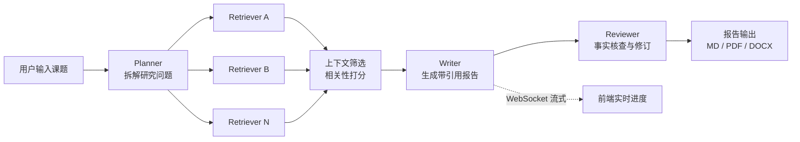
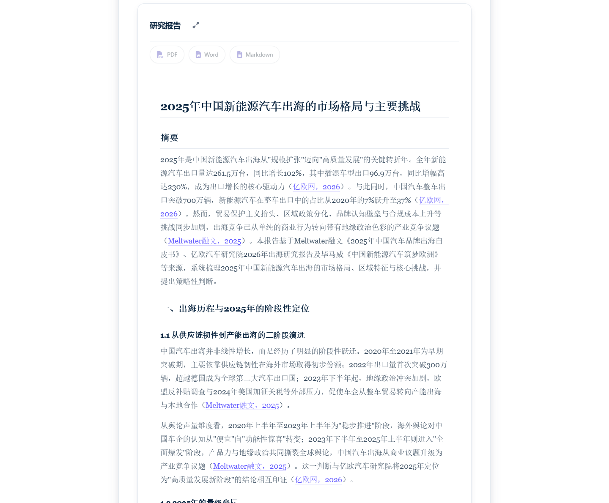

<div align="center">

# 🔎 Deep Research · 中文版

**输入一个课题，自动产出带引用来源的深度研究报告**

模型国产化接入 DeepSeek · 全链路中文化 · Stripe 风格交互重构

[](#)
[](#)
[](#)
[](./LICENSE)

</div>


## 这是什么

一个可本地运行的深度研究 Agent。输入课题后，它会自动完成：

```
拆解研究问题 → 多轮并行联网检索 → 抓取网页并筛选有效证据
→ 交叉验证与去重 → 生成带引用的长报告 → 导出 PDF / DOCX / Markdown
```

整个过程的思考链路通过 WebSocket 实时推送到前端，用户可以看着它「想」，而不是等一个转圈圈。

本项目基于开源项目 [assafelovic/gpt-researcher](https://github.com/assafelovic/gpt-researcher)（Apache-2.0）重构，在原有多智能体架构之上，完成了**模型国产化替代、全链路中文适配、前端视觉与交互重构**三项改造，并补齐了本地 Windows 环境下的可运行性。

## 核心改动

> 逐文件说明见 [CHANGES.md](./CHANGES.md)，所有改动可用 `git log` 逐个核对。

| 方向 | 具体做了什么 | 效果 |
| --- | --- | --- |
| **模型国产化** | 新增 `deepseek` Provider 分支，将 FAST/SMART/STRATEGIC 三层模型统一切换为 `deepseek-chat`；`deepseek-reasoner` 加入温度参数黑名单（该模型不接受 `temperature`） | 无需 OpenAI 账号即可运行，成本降至原来的 1/12 |
| **成本估算修正** | 原实现统一按 OpenAI 定价换算 Token 成本，对 DeepSeek 严重高估。新增 `DEEPSEEK_MODEL_PRICING` 定价表与按 Provider 分发的 `_lookup_pricing()` | 同一请求（1K 入 / 1K 出）估算值从 `$0.0175` 修正为 `$0.00137` |
| **嵌入模型替换** | 扩展 `embeddings.py` 的 `custom` 分支，支持任意 OpenAI 兼容的 Embedding 端点，接入 `BAAI/bge-m3`（硅基流动） | 中文语义检索质量明显优于 `text-embedding-ada-002`，且免翻墙 |
| **界面汉化** | 前端 172 处用户可见文案中文化，覆盖首页、表单、进度面板、报告区、提示语；后端枚举值与 API 字段保持英文原样 | 界面全中文，但接口契约未破坏，可无缝对接原版 API |
| **视觉重构** | 新增 `stripe-theme.css` + `stripe-ui.js` 覆盖层：紫蓝粉渐变光晕、24px 圆角卡片、按钮涟漪、悬停上浮、滚动入场 | 原 `styles.css` 的 2369 行一行未改，上游更新不会冲突 |
| **本地运行加固** | `main.py` 增加滚动日志（10MB × 5 份）；PDF 导出失败降级为 warning 而非中断整个请求 | Windows 下开箱即跑，单个模块失败不会拖垮主流程 |

## 技术栈

| 层 | 选型 |
| --- | --- |
| 后端 | Python 3.11+ / FastAPI / Uvicorn / WebSocket |
| Agent | 自研 Planner-Executor 架构，多智能体协作（规划 / 检索 / 写作 / 审校） |
| 模型 | DeepSeek（对话与推理）+ BAAI/bge-m3（Embedding） |
| 检索 | Tavily Search API，支持并发抓取与上下文压缩 |
| 前端 | 原生 HTML/CSS/JS（无框架依赖），WebSocket 流式渲染 |
| 导出 | Markdown / PDF / DOCX / JSON |

## 架构



## 快速开始

**环境要求**：Python 3.11+，Windows / macOS / Linux 均可

```bash
git clone https://github.com/li-yuzheng/gpt-researcher.git
cd gpt-researcher

python -m venv .venv
# Windows
.venv\Scripts\activate
# macOS / Linux
source .venv/bin/activate

pip install -r requirements.txt
```

**配置密钥**：复制 `.env.example` 为 `.env`，填入三项

```ini
DEEPSEEK_API_KEY=sk-xxxxxxxx          # https://platform.deepseek.com
CUSTOM_EMBEDDING_API_KEY=sk-xxxxxxxx  # 硅基流动等 OpenAI 兼容服务
TAVILY_API_KEY=tvly-xxxxxxxx          # https://tavily.com
LANGUAGE=chinese
```

**启动**

```bash
python main.py
```

浏览器打开 `http://127.0.0.1:8000`，输入课题即可。默认「概要报告」约 2 分钟、「详细报告」约 5-10 分钟，耗时取决于检索页数与模型响应速度。

> 项目自带一键改造脚本 `setup_deepseek.py`，会把上游原始仓库自动改造成当前状态（幂等，含 `.bak` 备份与 AST 校验）；`localize_frontend.py` 负责前端文案汉化。

## 报告效果



每份报告包含：结构化章节、关键数据来源、行内引用编号、末尾完整参考文献列表，可直接导出为 PDF / DOCX。

## 关键实现细节

**1. 在不破坏上游抽象的前提下接入新模型**

上游用 `FAST_LLM` / `SMART_LLM` / `STRATEGIC_LLM` 三个环境变量声明「provider:model」字符串，由 `llm_provider/generic/base.py` 按 provider 分发。接入 DeepSeek 没有改动调用方，只在分发处新增一个 `elif` 分支复用 OpenAI 兼容 SDK，并把 base_url 抽成环境变量：

```python
elif provider == "deepseek":
    base_url = os.environ.get("DEEPSEEK_BASE_URL", "https://api.deepseek.com")
```

这样未来换任何 OpenAI 兼容服务（月之暗面、通义、硅基流动），只需改 `.env` 一行。

**2. 成本估算为什么必须按 Provider 分支**

原实现在 `utils/costs.py` 里用一张全局定价表计算花费，DeepSeek 的单价只有 GPT-4 系的十分之一量级，统一换算会得出「一次研究花 $0.02」的错误结论，直接影响用户对成本的判断。修正后按 provider 选表，并对未知模型回落到 tiktoken 估算，两者都走同一个 `_lookup_pricing()` 入口。

**3. 为什么用覆盖层而不是改原样式**

原 `styles.css` 有 2369 行深色主题，直接改会和上游更新产生大面积冲突。改为在 `index.html` 末尾追加一个 `<link>` 引入覆盖层，用 CSS 变量与更高的选择器优先级覆盖颜色、圆角、阴影；交互动效独立放在 `stripe-ui.js`，用 `IntersectionObserver` 做滚动入场、用 `transform` 做按压回弹以保持 60fps。**上游文件零改动，随时可以同步新版。**

## 项目结构

```
gpt_researcher/          核心库：Agent 编排、检索、报告生成、Provider 抽象
├── config/              配置系统（env > 默认值）
├── llm_provider/        各厂商 LLM 适配层（含 deepseek 分支）
├── memory/              嵌入与向量检索（含 custom 嵌入端点）
├── utils/costs.py       Token 成本估算（按 Provider 分表）
backend/server/          FastAPI 服务：REST + WebSocket 流式推送
frontend/                前端页面
├── index.html           主界面（已汉化）
├── stripe-theme.css     视觉覆盖层（新增）
└── stripe-ui.js         交互动效（新增）
multi_agents/            多智能体模式（规划/执行/发布）
docs/screenshots/        README 截图
```

## 已验证

以上游 `3582a684` 为基线，用 `git worktree` 检出未改动副本，在同一依赖环境、同一套用例下对照运行：

| 版本 | 结果 | 失败用例集合 |
| --- | --- | --- |
| 上游原始版 | 30 failed / 544 passed | 基准 |
| 本项目 | 30 failed / 544 passed | 与基准 `diff` 完全一致 |

**零回归**。30 个失败用例来自上游本身（依赖外部网络与凭证），与本次改动无关。

## 已知限制

- **PDF 导出**：Windows 下依赖 GTK 运行库，未安装时导出会失败。已做异常降级，不影响报告生成，后续可换 `weasyprint` 或纯 Python 渲染方案。
- **检索质量**：强依赖 Tavily，免费额度有限；换用其他搜索源需要实现对应的 retriever 接口。
- **DeepSeek 上下文**：`deepseek-chat` 上下文为 64K，超长报告会触发分段生成，耗时上升。

## 许可与致谢

本项目基于 [assafelovic/gpt-researcher](https://github.com/assafelovic/gpt-researcher) 重构，遵循 [Apache-2.0](./LICENSE) 协议，原作者版权声明保留于 `LICENSE` 文件中，修改内容声明见 [CHANGES.md](./CHANGES.md)。

上游架构设计与核心能力归功于 [Assaf Elovic](https://github.com/assafelovic) 及所有贡献者。
